大家好，这里是时隔多日再次更新文章的鸽子早川智将。

上次更新已经是暑假的事情了。

最近也是终于有点时间去写点随笔了，于是就来填大坑了。

封面是生化危机李昂同志的神秘图，很符合我的状态。

---

## 近来情况

看我文章的应该都知道我已经变成健康早八的大学生了。

很荣幸能顶着一个啥都会一点又啥都想做的大脑去当纯血的文科生，对，**汉语言文学**。

不过上的课那叫一个匪夷所思，心理学啊，没啥实际意义只会空讲真正没有用处的理论的军事*理论*

还有什么...学发音的现代汉语，郁达夫风流史泛滥的中国近现代文学史，老师可以当思政老师的大学英语。

现代汉语这门课感觉就很让人...炸脑子。只能说感觉有点似了。

就不谈那么多我的学业情况了。

但至少我也是希望能学点进去的，因为感觉都没咋听课。

就这样吧...

也至少，我的好兄弟们，还有我社长还能和我每天吹水互相吐槽牢骚啥的。

没他和我的其他好友们我迟早突发脑溢血死掉。

---

## 项目进度

- #### 纳兰月香的心跳💓不已大冒险

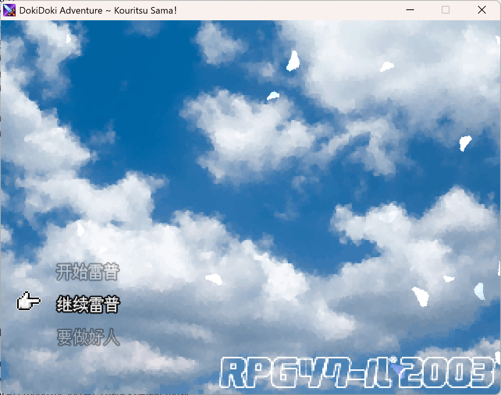

目前暂时处于停滞期。

引擎采用了**RPG Maker VX Ace**，不过刻意做旧做成了RPG Maker 200X的风格。

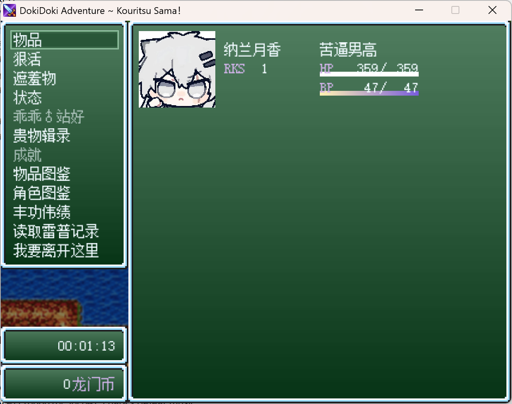

系统从成就到风格化的战斗系统都移植完毕了，顺带还修了splash的功能。

更何况系统音效上就是梗了...

说是生日礼物，其实我的社长，[纳兰月香](https://space.bilibili.com/1662471032)同学他已经不咋在意这一点了。

毕竟我已经单独陪这家伙（对，游戏主角和这个游戏的目标人员）去玩了一天了。

脚本上的功夫，大肥鱼的恩情还不完啊。

我觉得没人会看到这个地方，不过有人看到的话我会在看到提出的请求之后公开修补过的脚本。

大概就是把TDS Splash Screen的开屏Splash移植到了MOG 动态标题画面上。

---

- #### **FunkinHazard 系列**

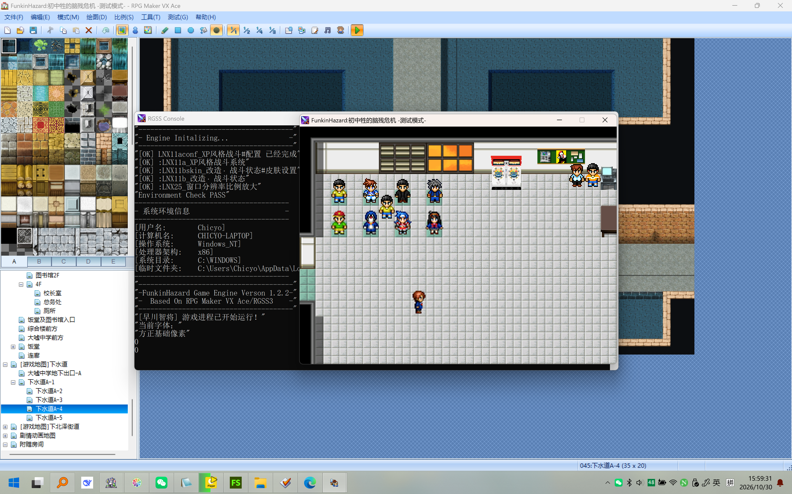

目前随缘更新。

系统都搭好了但是最麻烦的事件我就真的不想动了...好累啊😂。

RMVXAce的事件编辑器你就说反不反人类吧......（笑哭）

地图画到了已经完成的下水道部分，正在设计追逐战的路线图。

所以有些时候倒是也会逼着自己去做下去，毕竟好兄弟他们还在等着。

而且说实话我已经想快点讲FunkinHazard 3的故事了，关于那个自我封闭的孤独少年的内心的故事。

他的内心...我到现在也没想好究竟要用啥方法去表达。

另外这里有半个题外话，是我在考虑迁移到URGE的相关事宜。

不过说难听点我完全不需要任何跨平台特性来着，包括我自己现在的FKHD1都已经加了一套反其他平台运行的检测机制了，不是恶心玩家，而是**因为这个游戏离开Windows就会变成答辩**。

问就是用了一堆Win32API独有特性...除非像Oneshot那样做个伪虚拟机环境或者高度定制一个Winlator，否则跨平台体验我可以说一点也没有。

---

- #### **终之空 Ren'Py 1999重制版 汉化**

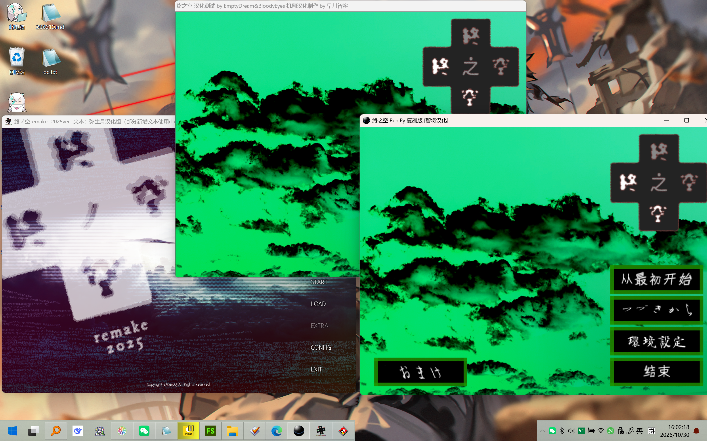

从左到右分别是官方使用Artemis Engine重置的终之空Remake 2025 Ver. | 使用[TnS_CN_Prog](https://bbs2.kdays.net/read/97265?page=e)进行补丁的Macromedia Director原版，和[英文社区制作的Ren'Py 复刻版](https://mon-panache.neocities.org/)。

弄这个东西纯粹也是随缘。

因为玩扶她自的作品本身就有点折磨，还加了一堆有的没的的哲学论（虽然说难听点确实是抖书袋。）

但是能给这个现代重制版加汉化还是很舒服的。

Ren'Py的系统大部分已经汉化完了，剩下的都是美工和游戏内容文本。

最早认识这个游戏...？主页刷到某个叫做爱心卡库拉怪兽的up发的解说视频吧。

只能说Mon! Panache团队还是很有技术力的。

下面俩图大概看看效果吧。

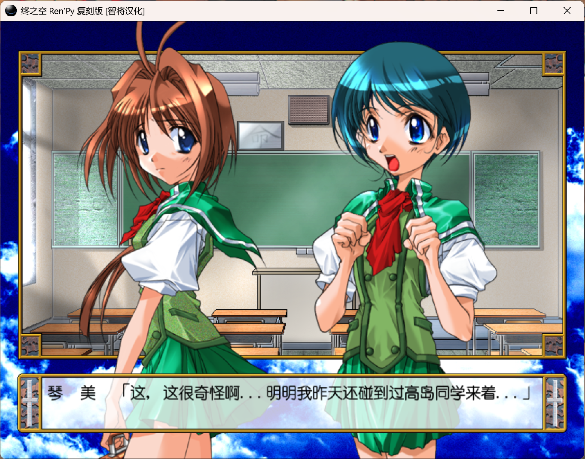

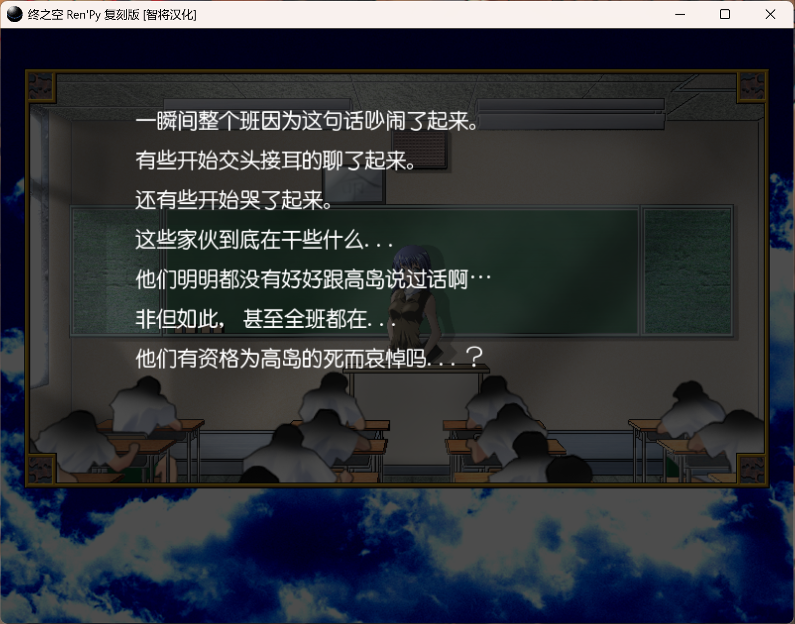

不过在这里分享一下我自己的一些研究吧。

首先我之前对Macromedia Director原版做过一些个人研究：

- KeroQ当初开发的时候好像有在Mac上搞过工程，因为文件内有些路径痕迹很明显的写了fromMac这种引入路径。其次Projector程序内也内捆了一个隐藏的DIR文件，一般情况下很容易忽略，用Projector Unpacker（Python脚本）即可解压出DIR(DXR加密档)文件。

- 原游戏用的字体是个理光的Siricus点阵字体，但是理光早就没做字体业务了，加上霓虹网络上也没人发字体文件，已经丢了...所以干脆不修了（放弃）

- 至少肉眼可见的......这个工程因为使用了一堆失传的Xtras,除非继续使用[TNS-CN-Prog项目](https://github.com/vanilla-translation-group/tns_cn_prog)，不然也就...除非去KeroQ变成仓库的大楼里找电脑找文件，否则完美汉化几乎不可能完成。

- 另外一提，Director编辑器本身只能在XP之类的环境运行，而7.0以前的版本运行又需要物理硬件密钥...
- 所以这里使用的是Director 8.5。

- 加上根据Director的运作机制，打包期间DIR程序的源码已经被抛弃，所以很多地方编辑器内无法运行...

- 以下是令人困惑的截图合集。

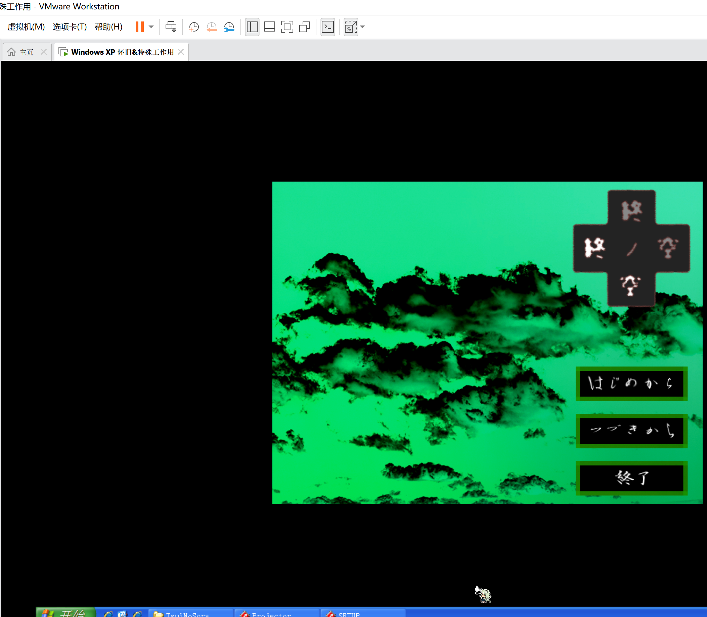

如图所示，这些是Director的界面 ，真不愧是Macromedia的大芬软件啊。

当年看或许很高级很先进，但是现在来看真的就是糟粕中的糟粕。

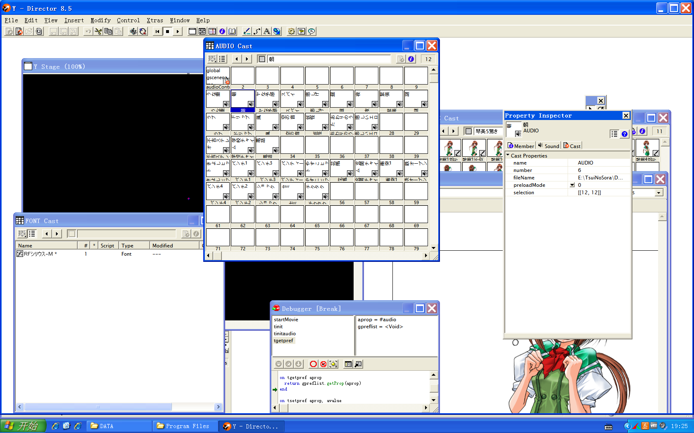

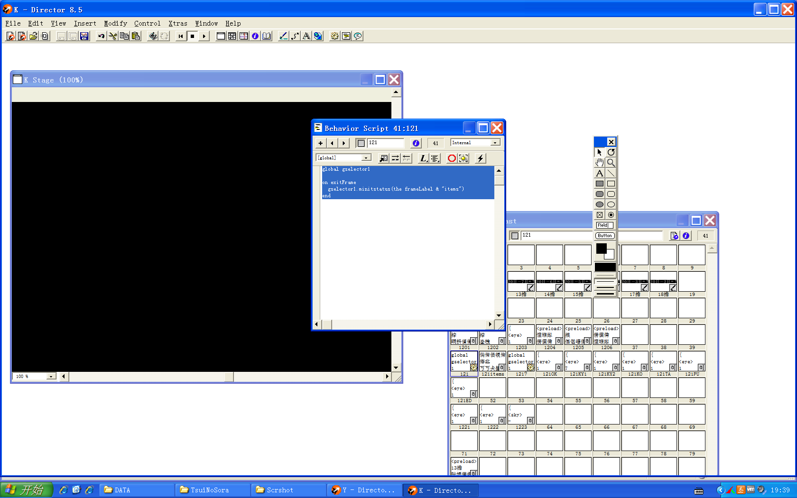

就不继续深入Director这个让人只感到困惑和过时的软件了。过时到汉化者前辈们都要写Hook把原本大芬一般美味的游戏系统加强，甚至像这个重制版一样移植到Ren'Py...

也是一样，如果有想深入研究的朋友，我会视情况而定提供文件或者直接GitHub配布。

附加：写这篇文章的时候又血气方刚打算接着战，然后：**浪费俩小时**。

这个部分耗费的精力过多了，多看点图吧......

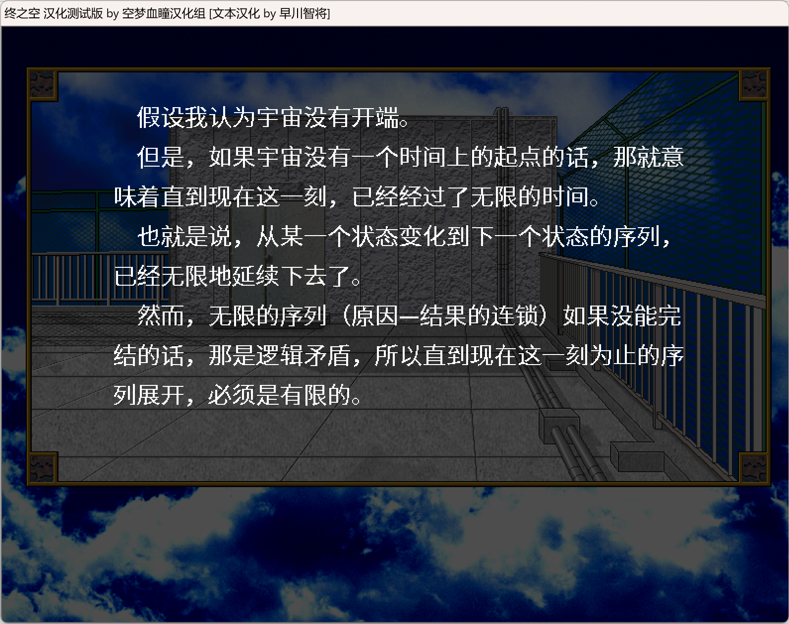

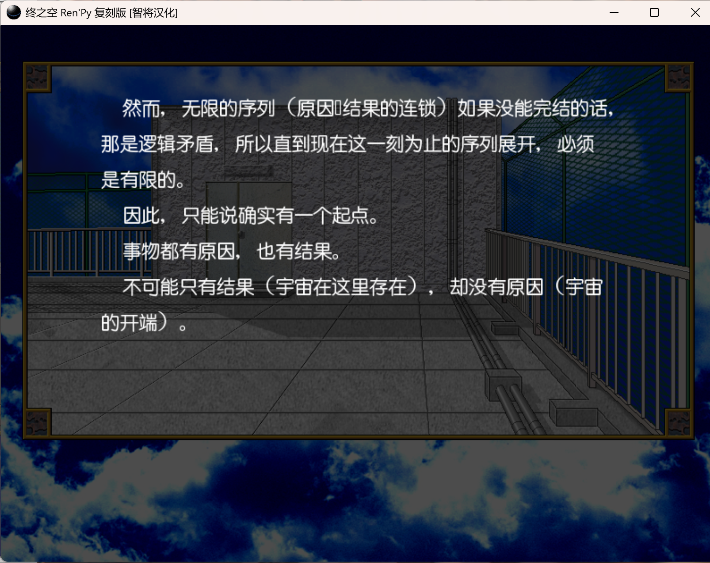

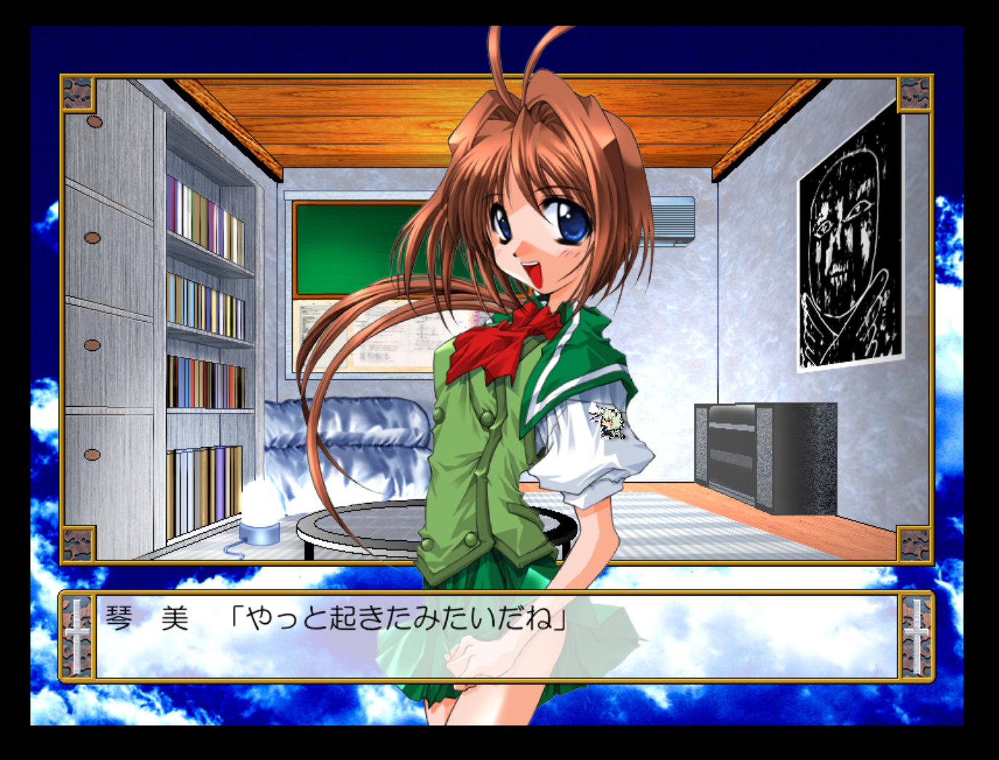

说实话，这东西会让我力竭而死的，于是我给它**捆起来丢机械硬盘上了**。

大概过几个月再做。

---

- **Dust Project（暂称)**

这应该是我第一次在这里提及这个项目。

本来之前就要提了，但是我忘记写完上一篇文章了，所以我就在这里开始了。

项目的启发来自[@哑言云二十四老师](https://weibo.com/u/3593881037)的插画集 **《致逝去的往日》** 这部作品的文本故事，并且我根据哑言老师的后记，去看了梶尾真治的 **《回忆爱玛侬》**（*漫画版），阿西莫夫那两篇短篇我还没看，分别是 **《永恒的终结》** 和 **《最后的问题》**。

这个项目目前清晰的是，设定了五个主要角色，和一些“故事进程”中的角色，以及，**永生**这个设定。

背景是远未来，是人类大规模灭亡后的一段文明重建的故事，**但不会止步于这个地方。**

~~也就是说还会再往后推，类似于时间过客吧。~~

主角是一对“义兄弟”——实际上是因为特殊原因同居多年的发小。一个是完全不知道自己物种的人造人，另一个是父母突然失踪未再出现的少年，两人被一场覆盖全人类的灾难抛到了十多年光景之后的地球。

因为或许的第一部不会有时间的极大跨度，所以开始的这个部分是没问题的。

但是未来的章节里，时间跨度是不可避免的。

主角们不会衰老，不会逝去，但是其他人会。

所以，

说实话，要让**在开始部分塑造出来的角色**在后面不得不活在过去，活在主要角色们的记忆里，这个负罪感是特别强的，很容易意难平。

加上我没法很清晰的把开始要写什么给勾勒出来，只有一个大概的方向（亦或是说连方向还是模糊的。）

但目前的部分其实很清晰。

人类少年比人造人少年早苏醒了一年，但是不可抗力因素使得他失去了记忆，在苏醒后离开了自己居住的浮空城，于地面上游荡一个月后遇到了前政府成员组织的幸存者组织，并且加入了他们，在人烟罕至的地面上游历一年。

而人造人少年一年之后苏醒，在重启浮空城系统之后前往地面，恰好遇到了自己正想要寻找的人类少年，却发现对方只是给了他一个温和的笑容，然后自我介绍了。

这个世界观的架构还在细化中（消极怠工ing）...我的好兄弟早川沐子倒是正在和我协作完成这个工作。

~~事实上，我很可能不得不往这个作品里塞入点BL，但至少是那种一般人也能接受的，毕竟设定的是双主角。何况我也没写过BL...但至少不会写成**卡米猫绝版同人文**那么尴尬。~~

人类毁灭这个想法多半来自~~不会数5~~的Bethesda，对，辐射4。

或许也来自哑言老师画笔下的那些世界。

我一直对那些被遗弃的景象，那些无人注意的景色很感兴趣。

更何况，那本画集很早之前就给还在上初二的我带来了极高的震撼。

人造人这个一方面是上面那个游戏里的司特吉同学，还有足立零（？？？），另外还有Cytus I的凡妮莎。

未来城市这些设定来自深空之眼。 ~~求求你别爆死可以吗代号弥弥尔😭😭~~

少年和少女的这个设定，多半也启发自安里アサト太太的 **《-86-不存在的战区》**。

然后我对这个世界观的印象曲是，灰澈老师的 **《森林》**，很长一段时间都会写的第一部分的印象曲是 **《深海流星群》**。我会更新放到主页的歌单内容里面。

第一部分就不会那么复杂，也不会那么沉重，应该是如同  **《深海流星群》** 那般洒满光辉的日常吧。

或许像是下面那样。

---

蔚蓝的天空，柔软厚实的层积云朵，云层缝隙之间洒下的阳光下。

少年和少女们穿着风衣外套，走在无人的城市里，执行着组织派发的任务。

偶尔少年们拌个嘴，或者是开个玩笑。

-“喂！应天！你倒是表个态啊———”

-“算了吧...而且你看我嘴里有东西也不好说话。”

-“呃，志刚，这是你吃的第几颗椰子糖了...”

小队里唯一的女生一脸无奈，但嘴角也带着微微的笑意。

-“你们依旧是不让人省心啊。”

微风拂过，人行道和仍未重新启用的道路上，草叶轻轻地晃动着。

无人的城市，正在一点点重新焕发着微弱但明媚的生机。

这个项目的更多细节就恕我不能讲述太多了。

---

## 尾声

写了这么多，或许就差不多了。

接下来也许两三周偶尔更新一下也说不定，毕竟大学破事多，而且不管是哪个大学生——就好比我兄弟和社长全都忙的要死没空回消息啦。

最近收到的远程控制协助请求变多了。

这代大学生连文件下载和浏览互联网获取免费资源都不会了吗...世风日下啊。

听课根本听不进去。

而且...回家好麻烦，但是又想回去了。

明天体测....很紧张，但是至少明天有......

### 哦天哪我们的不死的黑蛇塔露拉终于要上岛了！！！！！！

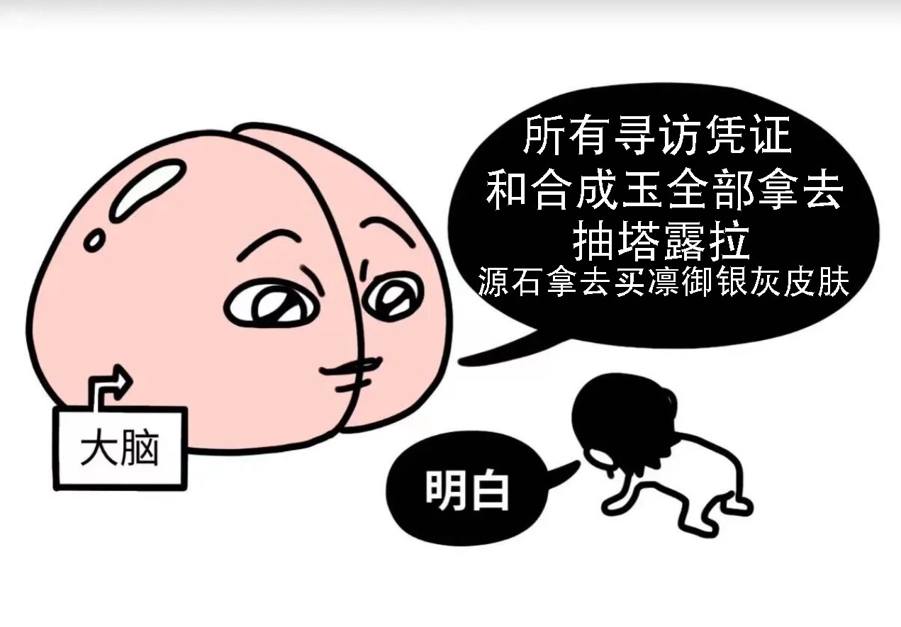

谢谢看完这篇文章的你。

## 音乐追加

 - 灰澈 《深海流星群》
 - 灰澈 《森林》
 - Elyonbeats 《Between The Stars》
 - r-906/IA 《脑内Disco》
 - MIMI/初音未来/可不 《妄想哀歌》
 - MIMI/初音未来 《哀の隙间》
 
 有必要追加说明第三首，这个是我玩Bakahazard-ARPG的时候在LEX潜意识世界那段听到的...
 
 要说感觉的话，感觉灵魂被震颤到了。歌词用的是梶浦由记的《媛星》的。梶浦语的确很有助于空灵感。
 
 说不定以后也会用到FunkinHazard 3rd里面。
 
---
 2026.10.31
 万圣节快乐！！🎃

